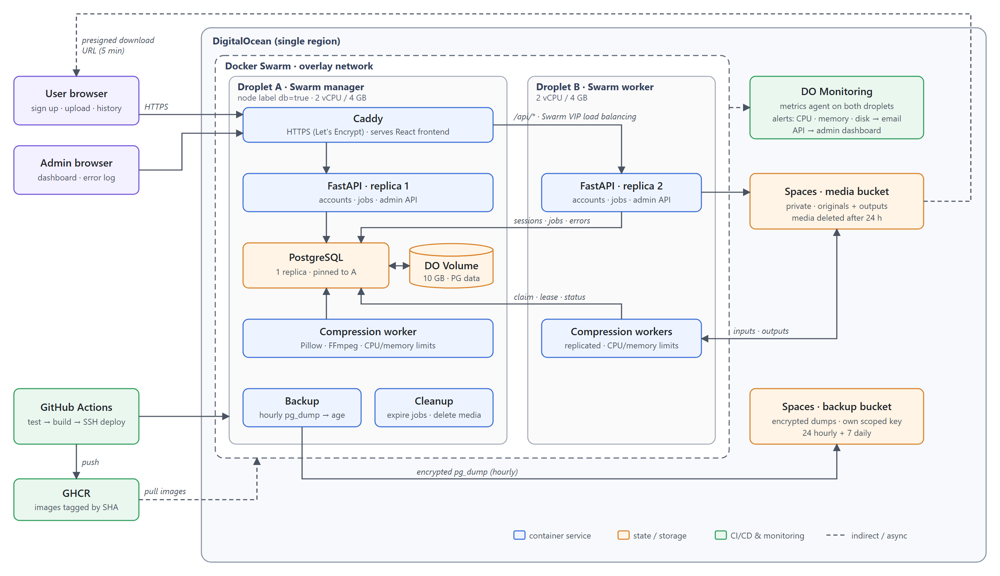

# FastZip - Project Proposal

**Course:** ECE1779 - Introduction to Cloud Computing  
**Team members:** Yuxin Duan, Kevin Li, Xi Chen, Ouyi Yang

## 1. Motivation

Photos and videos are central to communication and coursework, but large files are slow to upload and often exceed size limits: a short 1080p screen recording can be several times larger than Gmail's 25 MB attachment limit, and course platforms and messaging apps impose similar caps. Our target users are students submitting recorded presentations or video assignments, and people who regularly share media under such limits, often from laptops or phones with little processing power.

Desktop tools such as HandBrake require installation and encoding knowledge. Online compressors often cap file sizes, give little visibility into long-running jobs, and are vague about how long files are kept. Browser-side encoding avoids uploads but is slow and battery-intensive on low-end devices.

**FastZip** offloads image and video compression to cloud workers. Users register with an email address, upload a file, choose a preset, and download the result from any device; media is deleted automatically after 24 hours. The project also exercises core cloud challenges: distributed job coordination, state that survives container failures, secure handling of private files, and operational visibility.

## 2. Objectives, Architecture, and Key Features

### Objectives and scope

We will build a stateful cloud-native application with an asynchronous upload → compress → status → download workflow. Our goals are to:

1. Build a web frontend and a **Python FastAPI** backend with email accounts and an administrator portal.
2. Persist accounts, sessions, jobs, and error events in **PostgreSQL** on a **DigitalOcean Volume**.
3. Process jobs with replicated, containerized compression workers.
4. Deploy on two **DigitalOcean Droplets** with **Docker Swarm**, demonstrating replication, load balancing, monitoring, and alerting.
5. Implement **Security Enhancements**, a **CI/CD Pipeline**, and **Backup and Recovery**.

The MVP supports JPEG/PNG images (≤20 MB, ≤25 megapixels) and MP4 videos (≤100 MB, ≤1080p, ≤2 minutes), one file per job and at most three active jobs per account, with *smaller*, *balanced*, and *higher quality* presets. Users see job status (`QUEUED`, `PROCESSING`, `SUCCEEDED`, `FAILED`, `EXPIRED`), processing time, and size savings, and can download the original if compression does not help. Media expires after 24 hours; job history stays in the account. Email verification, password reset, batch jobs, editing, GPU encoding, and streaming are out of scope.

### System architecture

**Frontend and API:** Caddy terminates HTTPS, serves the built React frontend, and routes `/api/*` to FastAPI, so both share one origin and cookies stay first-party. FastAPI handles registration, login, and upload validation, stores the original in Spaces, creates a `QUEUED` job, and returns `202 Accepted`; the frontend then polls job status. Sessions live in PostgreSQL rather than process memory, so any API replica can serve any request without sticky sessions.

**Workers and coordination:** Workers compress images to WebP with Pillow and MP4 videos to H.264/AAC with FFmpeg, one job at a time under CPU, memory, and runtime limits. They claim jobs atomically with `FOR UPDATE SKIP LOCKED`; time-limited leases let another worker retry after a crash, and attempt IDs stop stale workers from overwriting newer results. Jobs that exhaust their retries become `FAILED` and are logged. Using PostgreSQL instead of Redis or RabbitMQ avoids extra infrastructure but requires custom retry logic.

**Media storage:** Private DigitalOcean Spaces holds originals and outputs, so workers on either node share files through the S3 API without a shared filesystem, at the cost of network transfer time. Downloads use 5-minute presigned URLs issued after an ownership check, keeping large transfers off the API at the cost of links being briefly shareable; a cleanup service deletes expired and orphaned objects.

**Administrator portal:** Admin accounts are created only by a server-side CLI on the Swarm manager, never through the web app, and admins see job metadata but not user media. The dashboard shows queue depth, jobs by status, throughput, failure rate, worker heartbeats, the last backup result, and droplet CPU/memory from the DigitalOcean Monitoring API. The error log lists structured events (service, node, job, message) that the API, workers, and backup service write to PostgreSQL, filterable by time and service.

### Course technologies

- **Docker and Docker Compose:** The frontend, API, worker, and backup service each have a Dockerfile. Compose runs them locally with PostgreSQL and MinIO (an S3-compatible stand-in for Spaces), so the full workflow runs without cloud credentials.
- **PostgreSQL and persistent storage:** PostgreSQL is a single-replica Swarm service pinned by node label to the droplet with an attached 10 GB DigitalOcean Volume, so data survives container restarts and redeployments. We avoid managed PostgreSQL because it would not demonstrate persistent storage. Alembic manages migrations.
- **Orchestration:** Droplet A (Swarm manager) runs Caddy, PostgreSQL, the backup and cleanup schedulers, and one API replica; Droplet B runs a second API replica. Workers spread across both nodes with CPU limits, and PostgreSQL has a resource reservation so encoding cannot starve it. Swarm provides overlay networking, VIP load balancing across API replicas, health checks, and rolling updates. We run one manager because two managers cannot tolerate a manager failure under Raft quorum; losing Droplet A stops the database and control plane, a risk we accept and mitigate with backups.
- **Monitoring and observability:** The DigitalOcean metrics agent runs on both droplets, with alert policies that email the team when CPU or memory stays above 80% or Volume disk usage exceeds 75%. Logs and the admin dashboard cover application health. We will compare throughput with one, two, and four workers.

### Advanced feature 1: Security Enhancements

**HTTPS** uses Caddy with automatic Let's Encrypt certificates for our domain (fastzip1779.site). Passwords are hashed with Argon2id, and registration and login are rate-limited. Random session IDs are kept in `HttpOnly`, `Secure`, `SameSite=Lax` cookies and revoked on logout, and state-changing requests require a CSRF token. **Role-based authorization** checks job ownership on every request, so users see and download only their own files, and restricts `/api/admin/*` to admins. Uploads are checked by file signature and FFprobe metadata; FFmpeg runs without a shell, and workers run as non-root. Database passwords, Spaces keys, the session secret, and the monitoring token are **Docker Swarm secrets**, and each Spaces key is scoped to one bucket.

**Verification:** Test cross-user and non-admin access, malformed and oversized uploads, secrets absent from images and `docker inspect`, and expired download links.

### Advanced feature 2: CI/CD Pipeline

On every pull request, **GitHub Actions** runs linting, unit tests, and API tests against a PostgreSQL service container. Merges to `main` build all images, tag them with the commit SHA, and push them to **GitHub Container Registry (GHCR)**. The deploy job connects to the manager over SSH, runs migrations, executes `docker stack deploy --with-registry-auth`, waits for convergence, and runs a smoke test that registers a user and completes an upload-to-download cycle. Swarm's `failure_action: rollback` reverts updates that fail health checks; if the smoke test fails, the workflow redeploys the previous tag. Migrations stay backward-compatible so rollback is safe.

**Verification:** A failing test must block deployment, and a deliberately broken image must roll back automatically.

### Advanced feature 3: Backup and Recovery

A single-replica backup service runs `pg_dump` hourly, encrypts each dump with an `age` public key, and uploads it to a separate private Spaces bucket, keeping 24 hourly and 7 daily copies. The private key stays offline, so a compromised server cannot read backups. Each run's result appears on the admin dashboard, and failures in the error log. The Volume survives container replacement, while backups cover corruption, accidental deletion, and droplet loss. Because media expires after 24 hours, a restore reconciles job records with objects still in Spaces and marks jobs with missing files `EXPIRED`.

**Verification:** Restore a backup into a fresh database, compare job records, and measure backup size, restore time, and the actual data-loss window. With successful hourly backups, our target recovery point is within one hour.

### Design tradeoffs and feasibility

Swarm has fewer features than Kubernetes but covers the replication, load balancing, rolling updates, and secrets we need with simpler operations. Strict file limits and bounded worker resources keep encoding load predictable on two droplets, at an estimated US$55/month (two 2 vCPU/4 GB droplets, a 10 GB Volume, and Spaces) covered by student credits.

## 3. Project Plan and Team Responsibilities

### Milestones

| Date (2026) | Work and evidence |
| --- | --- |
| Nov 2–7 | OpenAPI contract, database schema, repository, Compose skeleton; submit proposal. |
| Nov 8–14 | Accounts and sessions, upload/status/download API, job queue, image worker, frontend pages; end-to-end flow on Compose with MinIO. |
| Nov 15–21 | Video worker, Spaces, two-droplet Swarm with Volume, Caddy HTTPS, DigitalOcean alerts, admin dashboard. |
| Nov 22–24 | Core requirements demo-ready in the cloud; security and initial CI/CD; backup prototype; introduction (Nov 23) and slides (Nov 24). |
| Nov 25–Dec 2 | Present; complete error log, backup and restore drill, rollback test, and worker-scaling and failure-recovery measurements. |
| Dec 3–5 | Final validation, 2–5 minute video, `README.md`, and `ai-session.md`. |

### Ownership

| Member | Initial responsibility |
| --- | --- |
| Yuxin Duan | FastAPI endpoints, accounts and sessions, authorization, admin API, upload validation |
| Kevin Li | Compression workers (Pillow/FFmpeg), job claiming, leases and retries, Spaces storage module, cleanup service, worker heartbeats |
| Xi Chen | Compose, two-droplet Swarm, Volume, Caddy HTTPS, Swarm secrets, DigitalOcean monitoring and alerts |
| Ouyi Yang | React frontend (user pages, admin dashboard, error log), GitHub Actions, smoke and end-to-end tests |

Advanced feature owners: **Security**, Yuxin (HTTPS and secrets with Xi); **CI/CD**, Ouyi; **Backup and Recovery**, Xi (restore reconciliation with Kevin).

**Integration:** We fix the OpenAPI contract and Alembic schema first so the frontend can build against mocked responses. Workers depend on the schema and storage module; MinIO lets them integrate before Spaces is ready. CI/CD depends on the Swarm stack file, and the admin dashboard on the error-event and heartbeat tables. Work merges through reviewed pull requests with passing CI, and a weekly end-to-end smoke test on Compose later gates deployment.

**Risks:** Swarm networking, HTTPS, encoding load, and crash recovery are the main schedule risks, so we deploy early. If time runs short, Security and CI/CD take priority over Backup, and dashboard charts are cut before any required technology.

## 4. Initial Team Reasoning and AI-Assisted Exploration

### 4.1 Initial Team Reasoning

Our starting idea was an easy-to-use compressor for images and videos that would not require installing software. We initially imagined a single web service that both accepted uploads and ran compression, deployed with Docker Swarm on DigitalOcean and limited to common image formats and short MP4 videos to control cost.

Our open questions were whether CPU-heavy video encoding would block web requests, how several workers could coordinate without processing the same job twice, and how to share job state and files across containers on different nodes.

### 4.2 Exploration and Evaluation

Team discussion and AI-assisted exploration led us to separate the API from the workers so it stays responsive, with PostgreSQL for coordination and Spaces for shared media.

One AI-assisted discussion concerned worker coordination. `FOR UPDATE SKIP LOCKED` prevents duplicate claims, but when we asked what happens if a worker crashes mid-job, we concluded that locking alone would leave the job stuck or let a stale result overwrite a retry. We added leases, bounded retries, and attempt IDs, and will verify them by killing a worker mid-job and confirming the job is reclaimed and completed exactly once.

Our scope also changed. The first draft used anonymous browser sessions, so users lost their history when cookies were cleared and operators could not see failures; we replaced them with email accounts and an admin portal. An AI review of the draft against the rubric noted that we had not planned monitoring alerts or specified service placement on our two droplets; we confirmed both against the handout and added them.
