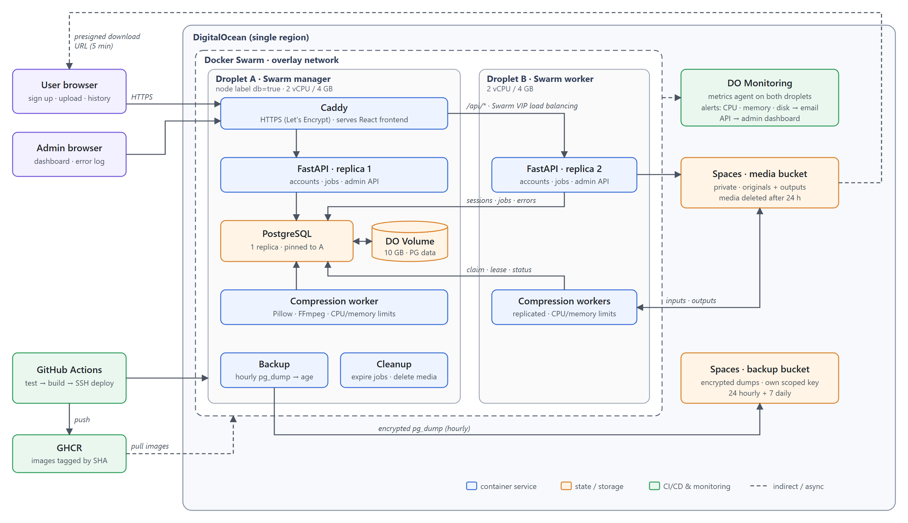

# Cloud Media Compressor（云端媒体压缩器）— 项目提案

**课程：** ECE1779 - 云计算导论  
**团队成员：** Yuxin Duan, Kevin Li, Xi Chen, Ouyi Yang

## 1. 项目动机

照片和视频是日常交流与课程作业的核心媒介，但大文件不仅上传缓慢，还经常超出大小限制：一段简短的 1080p 屏幕录像可能比 Gmail 的 25 MB 附件限制大好几倍，而课程平台和即时通讯应用也设有类似的上限。我们的目标用户是需要提交录制演示或视频作业的学生，以及经常在此类限制下通过算力有限的笔记本电脑或手机分享媒体文件的人群。

像 HandBrake 这样的桌面工具需要安装软件并具备编码知识。在线压缩工具通常会限制文件大小，对长时间运行的任务缺乏透明度，且对文件的保留时长含糊不清。浏览器端编码虽然避免了上传过程，但在低端设备上速度缓慢且极其耗电。

**Cloud Media Compressor** 将压缩任务卸载到云端工作节点（Worker）上执行。用户只需使用电子邮箱注册、上传文件、选择预设配置，即可从任何设备下载处理结果；媒体文件会在 24 小时后自动删除。该项目还涵盖了核心的云计算挑战：分布式任务协调、容器故障后的状态持久化、私有文件的安全处理以及运维可观测性。

## 2. 目标、架构与核心功能

### 目标与范围

我们将构建一个有状态的云原生应用，采用“上传 $\rightarrow$ 压缩 $\rightarrow$ 状态查询 $\rightarrow$ 下载”的异步工作流。我们的目标是：

1. 构建 Web 前端和 **Python FastAPI** 后端，支持邮箱账户体系及管理员门户。
2. 将账户、会话、任务和错误事件持久化存储在挂载了 **DigitalOcean Volume** 的 **PostgreSQL** 数据库中。
3. 使用多副本、容器化的压缩工作节点（Worker）处理任务。
4. 使用 **Docker Swarm** 在两台 **DigitalOcean Droplet** 上进行部署，演示副本扩展、负载均衡、监控与告警功能。
5. 实现**安全增强（Security Enhancements）**、**CI/CD 流水线（CI/CD Pipeline）**以及**备份与恢复（Backup and Recovery）**。

最小可行性产品（MVP）支持 JPEG/PNG 图像（$\le 20\text{ MB}$，$\le 25\text{ MP}$）和 MP4 视频（$\le 100\text{ MB}$，$\le 1080\text{p}$，$\le 2$ 分钟），每个任务处理一个文件，每个账户最多同时运行三个活跃任务，并提供*更小体积（smaller）*、*均衡（balanced）*和*更高质量（higher quality）*三种预设配置。用户可以查看任务状态（`QUEUED`、`PROCESSING`、`SUCCEEDED`、`FAILED`、`EXPIRED`）、处理耗时及节省的空间大小，且在压缩未减小体积时可直接下载原文件。媒体文件在 24 小时后过期清理；任务历史记录会保留在账户中。邮箱验证、密码重置、批量任务、视频编辑、GPU 编码和流媒体播放不在本次项目范围内。

### 系统架构

**前端与 API：** Caddy 负责终止 HTTPS 连接、提供构建好的 React 前端静态资源，并将 `/api/*` 路由至 FastAPI，从而使前后端共享同一源（Origin）并保持第一方 Cookie。FastAPI 处理注册、登录和上传验证，将原始文件存储到 Spaces，创建状态为 `QUEUED` 的任务并返回 `202 Accepted`；随后前端轮询任务状态。会话存储在 PostgreSQL 而非进程内存中，因此任何 API 副本都可以处理任意请求，无需粘性会话（Sticky Sessions）。

**工作节点与协调：** 工作节点使用 Pillow 将图像压缩为 WebP 格式，使用 FFmpeg 将 MP4 视频压缩为 H.264/AAC 格式，并在 CPU、内存和运行时间限制下每次仅处理一个任务。节点通过 `FOR UPDATE SKIP LOCKED` 原子化地认领任务；限时租约（Lease）机制允许其他节点在发生崩溃后重试任务，而尝试 ID（Attempt ID）则可防止失效节点覆盖较新的处理结果。耗尽重试次数的任务将被标记为 `FAILED` 并记录到日志中。使用 PostgreSQL 代替 Redis 或 RabbitMQ 避免了额外的基础设施开销，但需要实现自定义的重试逻辑。

**媒体存储：** 私有的 DigitalOcean Spaces 负责保存原始文件和输出文件，使两个节点上的工作节点无需共享文件系统即可通过 S3 API 共享文件，代价是会产生网络传输耗时。文件下载采用在验证所有权后签发的 5 分钟预签名 URL（Presigned URL），以链接可短暂分享为代价避免大文件传输占用 API 带宽；同时由清理服务定期删除过期和孤立的对象。

**管理员门户：** 管理员账户仅能通过 Swarm 管理节点上的服务端 CLI 创建，绝不通过 Web 应用开放，且管理员只能查看任务元数据而无法访问用户的媒体文件。管理仪表盘展示队列深度、各状态任务数、吞吐量、失败率、工作节点心跳、最近一次备份结果，以及来自 DigitalOcean Monitoring API 的 Droplet CPU 和内存使用率。错误日志列出由 API、工作节点和备份服务写入 PostgreSQL 的结构化事件（包含服务、节点、任务和消息），并支持按时间和所属服务进行筛选。

### 课程核心技术

- **Docker 与 Docker Compose：** 前端、API、工作节点和备份服务各自拥有独立的 Dockerfile。Compose 可在本地配合 PostgreSQL 和 MinIO（兼容 S3 的 Spaces 替代方案）运行这些服务，无需云端凭证即可跑通完整工作流。
- **PostgreSQL 与持久化存储：** PostgreSQL 作为单副本 Swarm 服务运行，通过节点标签固定在挂载了 10 GB DigitalOcean Volume 的 Droplet 上，确保数据在容器重启和重新部署后依然保留。我们刻意不采用托管版 PostgreSQL，因为那无法演示持久化存储机制。使用 Alembic 管理数据库迁移。
- **容器编排：** Droplet A（Swarm 管理节点）运行 Caddy、PostgreSQL、备份与清理调度器以及一个 API 副本；Droplet B 运行第二个 API 副本。工作节点在带有 CPU 限制的情况下分布在两个节点上，PostgreSQL 则配有资源预留以防编码任务耗尽其资源。Swarm 提供跨主机 Overlay 网络、跨 API 副本的 VIP 负载均衡、健康检查与滚动更新。由于两个管理节点在 Raft 仲裁机制下无法容忍管理节点故障，我们仅运行单个管理节点；失去 Droplet A 会导致数据库和控制平面停止，我们接受这一风险并通过备份加以缓解。
- **监控与可观测性：** 两台 Droplet 均运行 DigitalOcean 指标代理，并配置告警策略，在 CPU 或内存持续超过 80% 或 Volume 磁盘使用率超过 75% 时向团队发送邮件。日志和管理仪表盘涵盖应用健康状态。我们将对比 1、2 和 4 个工作节点下的吞吐量表现。

### 高级特性 1：安全增强（Security Enhancements）

**HTTPS** 使用 Caddy 为我们的域名（fastzip1779.site）自动申请与续期 Let's Encrypt 证书。密码采用 Argon2id 进行哈希加密，且注册和登录接口均设有速率限制。随机生成的会话 ID 保存在带有 `HttpOnly`、`Secure`、`SameSite=Lax` 属性的 Cookie 中并在注销时吊销，同时所有改变状态的请求均需提供 CSRF 令牌。**基于角色的授权（Role-based authorization）**会在每次请求时校验任务所有权，确保用户只能查看和下载自己的文件，并将 `/api/admin/*` 限制为仅管理员可访问。上传文件需经过文件签名（File Signature）和 FFprobe 元数据双重校验；FFmpeg 以无 Shell 方式运行，工作节点则以非 root 用户身份运行。数据库密码、Spaces 密钥、会话密钥和监控令牌均作为 **Docker Swarm secrets** 存储，且每个 Spaces 密钥仅限定访问单个存储桶。

**验证方式：** 测试跨用户及非管理员越权访问、格式错误和超大文件上传、确保镜像与 `docker inspect` 输出中不包含明文密钥，以及测试过期下载链接的拦截效果。

### 高级特性 2：CI/CD 流水线（CI/CD Pipeline）

在每次提交 Pull Request 时，**GitHub Actions** 会针对 PostgreSQL 服务容器运行代码检查（Linting）、单元测试和 API 测试。合并到 `main` 分支后会构建所有镜像，打上提交 SHA 标签并推送至 **GitHub Container Registry (GHCR)**。部署任务通过 SSH 连接到 Swarm 管理节点，运行数据库迁移，执行 `docker stack deploy --with-registry-auth`，等待服务收敛，然后运行冒烟测试（注册用户并完成一次从上传到下载的完整周期）。Swarm 的 `failure_action: rollback` 机制会自动回滚未通过健康检查的更新；若冒烟测试失败，工作流将重新部署上一个镜像标签。数据库迁移保持向后兼容以确保回滚安全。

**验证方式：** 失败的测试必须能够阻断部署，且故意引入故障的镜像必须能够触发自动回滚。

### 高级特性 3：备份与恢复（Backup and Recovery）

单副本备份服务每小时运行一次 `pg_dump`，使用 `age` 公钥加密每个转储文件，并上传至独立的私有 Spaces 存储桶，保留 24 份每小时备份和 7 份每日备份。私钥离线保存，因此即便服务器被攻破也无法读取备份内容。每次备份的结果都会显示在管理仪表盘上，失败信息则会记录到错误日志中。Volume 可应对容器替换，而备份则可防范数据损坏、误删和 Droplet 丢失。由于媒体文件在 24 小时后过期，恢复操作会将任务记录与 Spaces 中仍存在的对象进行对账，并将文件缺失的任务标记为 `EXPIRED`。

**验证方式：** 将数据恢复到全新数据库中并比对记录，同时测量备份体积、恢复耗时以及数据丢失窗口（最多一小时）。

### 设计权衡与可行性

Swarm 的功能虽少于 Kubernetes，但以更简单的运维成本涵盖了我们所需的副本扩展、负载均衡、滚动更新和密钥管理功能。严格的文件限制和受控的工作节点资源使两台 Droplet 上的编码负载保持可预测，预估每月成本约为 55 美元（包含两台 2 vCPU/4 GB Droplet、一个 10 GB Volume 及 Spaces 存储），可由学生额度覆盖。

## 3. 项目计划与团队分工

### 里程碑

| 日期 (2026) | 工作内容与交付成果 |
| --- | --- |
| 11月2日–7日 | 制定 OpenAPI 契约、数据库模式（Schema）、代码仓库及 Compose 骨架；提交项目提案。 |
| 11月8日–14日 | 完成账户与会话、上传/状态/下载 API、任务队列、图像压缩节点和前端页面；基于 Compose 与 MinIO 跑通端到端流程。 |
| 11月15日–21日 | 完成视频压缩节点、Spaces 集成、带 Volume 的双节点 Swarm 部署、Caddy HTTPS、DigitalOcean 告警以及管理员仪表盘。 |
| 11月22日–24日 | 云端核心需求达到可演示状态；完成安全增强与初步 CI/CD；备份原型；项目介绍（11月23日）和演示文稿（11月24日）。 |
| 11月25日–12月2日 | 进行课堂展示；完成错误日志、备份与恢复演练、回滚测试，以及工作节点扩缩容与故障恢复测量。 |
| 12月3日–5日 | 完成最终验证、2–5 分钟演示视频、`README.md` 以及 `ai-session.md`。 |

### 团队职责分工

| 成员 | 初始负责模块 |
| --- | --- |
| Yuxin Duan | FastAPI 接口、账户与会话、权限控制、管理员 API、上传验证 |
| Kevin Li | 压缩工作节点（Pillow/FFmpeg）、任务认领、租约与重试机制、Spaces 存储模块、清理服务、工作节点心跳 |
| Xi Chen | Compose、双节点 Swarm、Volume、Caddy HTTPS、Swarm 密钥、DigitalOcean 监控与告警 |
| Ouyi Yang | React 前端（用户页面、管理员仪表盘、错误日志）、GitHub Actions、冒烟测试与端到端测试 |

高级特性负责人：**安全增强**由 Yuxin 负责（HTTPS 与密钥管理与 Xi 协作）；**CI/CD** 由 Ouyi 负责；**备份与恢复**由 Xi 负责（恢复对账逻辑与 Kevin 协作）。

**系统集成：** 我们会优先敲定 OpenAPI 契约和 Alembic 数据库模式，以便前端可以基于 Mock 响应并行开发。工作节点依赖于数据库模式和存储模块；MinIO 可让它们在 Spaces 就绪前完成集成。CI/CD 依赖于 Swarm 堆栈配置文件，而管理员仪表盘则依赖于错误事件表和心跳表。所有代码通过经过评审且 CI 测试通过的 Pull Request 进行合并，每周在 Compose 上运行的端到端冒烟测试将在后期作为部署门禁。

**风险管控：** Swarm 网络、HTTPS 配置、编码负载和崩溃恢复是主要的进度风险点，因此我们会尽早进行云端部署。如果时间紧张，安全增强和 CI/CD 的优先级将高于备份功能，且在缩减范围时会优先砍掉仪表盘图表而非任何必修技术要求。

## 4. 团队初期构思与 AI 辅助探索

### 4.1 团队初期构思

我们的初始想法是做一个无需安装软件、易于使用的图像和视频压缩工具。起初我们设想构建一个同时接收上传和执行压缩的单一 Web 服务，利用 Docker Swarm 部署在 DigitalOcean 上，并限制为常见图像格式和简短的 MP4 视频以控制成本。

当时面临的未决问题包括：高 CPU 负载的视频编码是否会阻塞 Web 请求、多个工作节点如何协同工作以避免重复处理同一任务，以及如何跨不同节点上的容器共享任务状态与文件。

### 4.2 探索与评估

经过团队讨论与 AI 辅助探索，我们决定将 API 与工作节点分离以保持接口响应速度，并采用 PostgreSQL 进行任务协调、使用 Spaces 共享媒体文件。

其中一次 AI 辅助讨论聚焦于工作节点协调机制。`FOR UPDATE SKIP LOCKED` 虽然能防止重复认领任务，但当我们探讨工作节点在任务中途崩溃会发生什么时，得出的结论是仅靠锁机制会导致任务卡死，或让失效节点的结果覆盖重试结果。因此我们引入了租约机制、有限次数的重试和尝试 ID，并计划通过中途强制终止工作节点来验证任务能否被重新认领且仅完成一次。

项目范围也经历了调整。初稿采用匿名浏览器会话，导致用户清除 Cookie 后就会丢失历史记录，且运维人员无法排查失败原因；于是我们将其替换为邮箱账户体系和管理员门户。此外，AI 对照评分标准审阅初稿时指出，我们尚未规划监控告警，也未明确服务在两台 Droplet 上的分布位置；我们在核对课程讲义后补充了这两项设计。